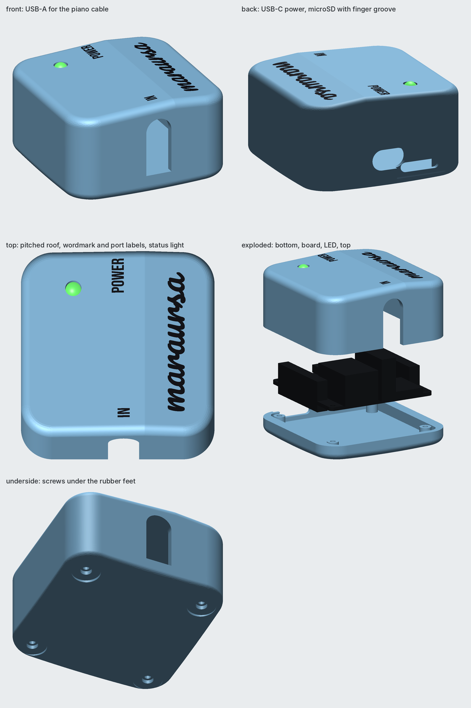
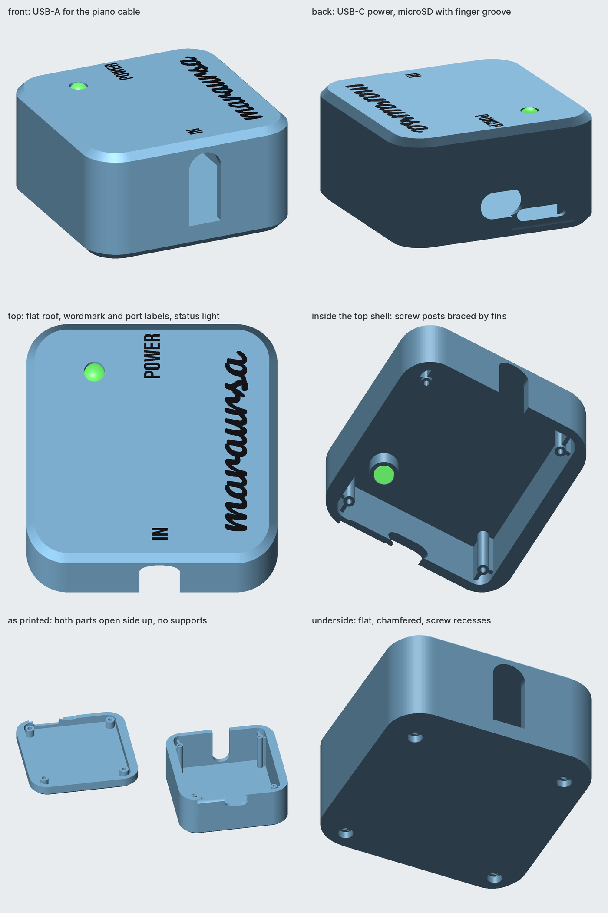

# pianolog enclosure



A two-part case for the Waveshare ESP32-P4-NANO: 61 × 61 × 34.6 mm, rounded corners, a
shallow pitched roof (the ridge runs front to back, 2 mm high) and a gently domed bottom.
`maraursa` is set in Pacifico along the narrow side of the roof, 1 mm deep; **IN** and
**POWER** (Bebas Neue) sit next to the piano and power sockets. A holder for the optional 5 mm
status LED is in the back-left corner. Openings for USB-A (piano cable, front), USB-C (power)
and the microSD card (back, with a finger groove). The pictures show it in a light blue with
black lettering; any colour works.

**Not test-fitted yet.** The board outline, mounting holes and the side-to-side position of
the connectors come from Waveshare's dimension drawing. Connector heights and how far they
stick out past the board edge are estimated from photos (see below). The openings are sized
for plug bodies, which leaves about 1 mm of slack, but measure before paying for a print.

## Files

| File | Use |
|------|-----|
| `out/case_top.step`, `out/case_bottom.step` | for print services (exact curves), and for editing in CAD |
| `out/case_top.3mf`, `out/case_bottom.3mf` | for home slicers (Bambu Studio, PrusaSlicer, Cura); carries units |
| `out/case_top.stl`, `out/case_bottom.stl` | for anything else |
| `out/case_top_text.3mf`, `.stl`, `.step` | the lettering as its own body, for printing it in a second colour (see below) |
| `out/board.step`, `out/led.stl` | the rough board and LED models used for the clearance check |
| `out/fdm_case_*.{step,3mf,stl}` | the **FDM variant** for a home filament printer (see below) |
| `pianolog_case.py`, `pianolog_case_fdm.py` | the parametric sources; `render.py` (or `render.py fdm`) makes the preview pictures |
| `overhangs.py` | rough check of how much surface would need support in a given print orientation |
| `fonts/` | Pacifico and Bebas Neue, both under the SIL Open Font License |

```sh
pip install cadquery trimesh
python pianolog_case.py      # rebuilds out/, prints a clearance check against the board model
python render.py             # optional: preview pictures
```

## Measure these first

With calipers, on your board. Change the value in `pianolog_case.py` if it differs by more
than about 0.5 mm, then rebuild.

| Parameter | What to measure | Estimate |
|-----------|-----------------|----------|
| `USBA_FACE_Y` | how far the USB-A socket sticks out past the front edge of the board | 2.7 mm |
| `USBA_Z` | top of the USB-A socket above the board's underside | measured: 20 mm |
| `USBC_FACE_Y` | how far the USB-C socket sticks out past the back edge | 1.1 mm (from Waveshare's drawing) |
| `USBC_Z` | height of the USB-C socket above the board surface | 3.3 mm |
| `RJ45_H`, `RJ45_FACE_Y` | Ethernet socket height and overhang | 13.6 / 1.6 mm |
| `SD_X` | microSD slot position | 6.51 mm from the edge (Waveshare's drawing) |
| `SD_Z` | height of the microSD slot under the board | 1.9 mm |
| `HEADER_PINS_BELOW` | how far anything sticks out under the board | measured 2 mm; 3.2 mm allowed |
| hole diameter | the four corner holes must take an M2 screw | ~2.9 mm (edge 1 mm from the board edge) |

## Parts

* 4 × M2 × 12 mm screws with a low head (≤ 1.5 mm high, ≤ 4 mm across), e.g. DIN 84 /
  ISO 1207 cheese head. They go in from below, through the bottom shell and the board,
  and cut their own thread in the top shell's posts.
* Optional: one 5 mm WS2812D-F5 LED for the status light, 3 female-female jumpers and a
  drop of glue (CA or hot glue).
* 4 × self-adhesive rubber feet, 10 mm across, 2.5–3 mm high. They sit over the screw heads
  and keep the domed bottom from rocking.

## Printing

* **Best result: MJF (HP Multi Jet Fusion) in PA12 nylon, dyed black.** Matte, even,
  no layer lines, so the gentle domes come out smooth; tough enough for the thin screw
  posts. Ask for vapor smoothing if you want a satin, near-smooth surface. Send the STEP files.
* **SLA resin, black:** the smoothest and most glossy-capable surface; more brittle, so
  don't overtighten the screws.
* **FDM at home: use the FDM variant, `out/fdm_case_top.*` and `out/fdm_case_bottom.*`.**
  The case above suits powder and resin printers; on a filament printer its pitched roof and
  domed bottom would need about 29 cm² of support per part and show stair-step contour lines.
  The FDM variant has the same inside, openings, screws and LED holder, reshaped to print
  with no supports at all:

  

  * flat roof and flat bottom, each printed **outside face down, open side up**, so both
    show the smooth (or textured) finish of the build plate;
  * 45° chamfers instead of fillets on the two edges that touch the plate;
  * the lettering engraved into the face on the plate (short bridges over the letters);
  * fins bracing each screw post to the nearest walls;
  * a two-layer sacrificial bridge above each screw-head recess, drawn for **0.2 mm layers**
    (the hole-bridging trick): leave "detect bridging perimeters" on and supports off;
  * the USB-A opening runs out through the rim as a slot.

  Slicer: PETG (or PLA if it never sits in sun or a hot car), 0.2 mm layers, **4 perimeters**
  so the posts are solid, 15–20 % infill, no supports, no brim needed. A textured PEI sheet
  gives the roof a uniform matte grain. Print the bottom shell first as a fit test.
  `python overhangs.py --flip out/fdm_case_top.stl` reports what is left to bridge: the letter
  floors, the two screw bridges and the 45° chamfers, all of which print without support.

## Lettering in a second colour

* **MJF or SLA** (one colour per print): fill the 1 mm engraving with acrylic paint or a
  paint marker and wipe the surface clean with a slightly damp cloth before it dries.
* **FDM with several filaments** (e.g. a Bambu printer with AMS): load `fdm_case_top.3mf` and
  `fdm_case_top_text.3mf` together as one object with two parts, and give the text part the
  second filament.

## Assembly

0. Status light (optional): push the LED up into the sleeve under the top shell until its
   rim stops against the step and the tip stands 0.8 mm proud. Put a drop of glue on the
   rim, let it set, then bend the legs sideways and fit the jumpers (see the main README for
   the wiring). If the hole is tight, run a 5 mm drill through it by hand first.
1. Put the board into the bottom shell on its four standoffs, microSD slot at the groove.
2. Lower the top shell over it; the USB-A sits in the front opening.
3. Turn over and drive the four M2 × 12 screws until snug. Don't force them: the posts
   in the top shell are 3.4 mm thin, because the pin headers start 2.45 mm from the holes.
4. Stick the rubber feet over the screw heads.
