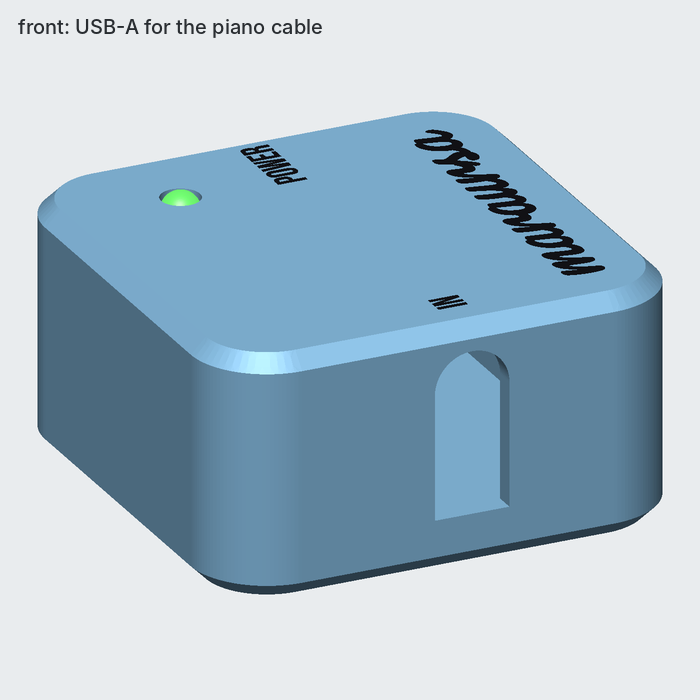
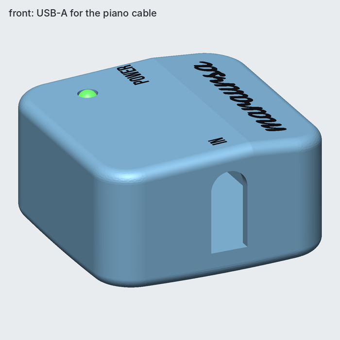

# pianolog enclosure

A two-part case for the Waveshare ESP32-P4-NANO, in two versions with the same inside,
openings, screws, lettering and status light:

| | [**`fdm/`: the main version**](fdm/README.md) | [`pitched-roof/`: the ambitious version](pitched-roof/README.md) |
|---|---|---|
| |  |  |
| Shape | flat roof and bottom, 45° chamfers | shallow pitched roof, domed bottom, rounded edges |
| Size | 61 × 61 × 31.6 mm | 61 × 61 × 34.6 mm |
| Print on | any home filament printer, **no supports** | MJF / SLS (nylon powder) or SLA (resin), from a print service |
| Cost | a few złoty of filament | roughly 100–250 zł for the pair (estimate, not a quote) |

**Start with `fdm/`.** It prints at home in a few hours, so it is the cheap way to check the
fit against your board and to have a working case. `pitched-roof/` is the nicer-looking
object, but it depends on a print service, and on a filament printer it would need about
29 cm² of support per part and show its slopes as stair steps.

Both cases have only two openings: USB-A (piano cable, front) and USB-C (power, back). The
microSD card stays sealed inside; takes download over Wi-Fi, and to swap the card you take
the four screws out. `maraursa` is set in Pacifico on the roof, 1 mm deep; **IN** and
**POWER** (Bebas Neue) sit next to the sockets. A holder for the optional 5 mm status LED is
in the back-left corner.

**Not test-fitted yet.** The board outline, mounting holes and the side-to-side position of
the connectors come from Waveshare's dimension drawing. Connector heights and how far they
stick out past the board edge are estimated from photos (see below). The openings are sized
for plug bodies, which leaves about 1 mm of slack, but measure before paying for a print.

## Layout

| Path | What it is |
|------|------------|
| `common.py` | everything both versions share: board dimensions, inside of the case, openings, screws, lettering, status light, export and clearance check |
| `fdm/case.py`, `fdm/out/` | the main version and its print files |
| `pitched-roof/case.py`, `pitched-roof/out/` | the ambitious version and its print files |
| `reference/board.step` | the rough board model used for the clearance check |
| `render.py` | preview pictures: `python render.py fdm` or `python render.py pitched-roof` |
| `overhangs.py` | rough check of how much surface would need support in a given print orientation |
| `fonts/` | Pacifico and Bebas Neue, both under the SIL Open Font License |

Each `out/` folder holds the same files:

| File | Use |
|------|-----|
| `top.step`, `bottom.step` | for print services (exact curves), and for editing in CAD |
| `top.3mf`, `bottom.3mf` | for home slicers (Bambu Studio, PrusaSlicer, Cura); carries units |
| `top.stl`, `bottom.stl` | for anything else |
| `top_text.{3mf,stl,step}` | the lettering as its own body, for printing it in a second colour |
| `led.stl` | the status LED, for the clearance check and pictures |

```sh
pip install cadquery trimesh
python fdm/case.py              # rebuilds fdm/out/, prints a clearance check against the board
python pitched-roof/case.py     # same for pitched-roof/out/
python render.py fdm            # optional: preview pictures
```

A change in `common.py` (a measurement, a font, the LED position) affects both versions:
rebuild both.

## Measure these first

With calipers, on your board. Change the value in `common.py` if it differs by more than
about 0.5 mm, then rebuild.

| Parameter | What to measure | Estimate |
|-----------|-----------------|----------|
| `USBA_FACE_Y` | how far the USB-A socket sticks out past the front edge of the board | 2.7 mm |
| `USBA_Z` | top of the USB-A socket above the board's underside | measured: 20 mm |
| `USBC_FACE_Y` | how far the USB-C socket sticks out past the back edge | 1.1 mm (from Waveshare's drawing) |
| `USBC_Z` | height of the USB-C socket above the board surface | 3.3 mm |
| `RJ45_H`, `RJ45_FACE_Y` | Ethernet socket height and overhang | 13.6 / 1.6 mm |
| `SD_X`, `SD_Z` | microSD slot position and height under the board (clearance only) | 6.51 mm from the edge / 1.9 mm |
| `HEADER_PINS_BELOW` | how far anything sticks out under the board | measured 2 mm; 3.2 mm allowed |
| hole diameter | the four corner holes must take an M2 screw | ~2.9 mm (edge 1 mm from the board edge) |

## Parts

* 4 × M2 × 12 mm screws with a low head (≤ 1.5 mm high, ≤ 4 mm across), e.g. DIN 84 /
  ISO 1207 cheese head. They go in from below, through the bottom shell and the board,
  and cut their own thread in the top shell's posts.
* Optional: one 5 mm WS2812D-F5 LED for the status light, 3 female-female jumpers and a
  drop of glue (CA or hot glue).
* 4 × self-adhesive rubber feet, 10 mm across, 2.5–3 mm high, stuck over the screw heads.

## Assembly

0. Status light (optional): push the LED up into the sleeve under the top shell until its
   rim stops against the step and the tip stands 0.8 mm proud. Put a drop of glue on the
   rim, let it set, then bend the legs sideways and fit the jumpers (see the main README for
   the wiring). If the hole is tight, run a 5 mm drill through it by hand first.
1. Put the card in the microSD slot, then the board into the bottom shell on its four
   standoffs, USB-C towards the back.
2. Lower the top shell over it; the USB-A sits in the front opening.
3. Turn over and drive the four M2 × 12 screws until snug. Don't force them: the posts
   in the top shell are 3.4 mm thin, because the pin headers start 2.45 mm from the holes.
4. Stick the rubber feet over the screw heads.
