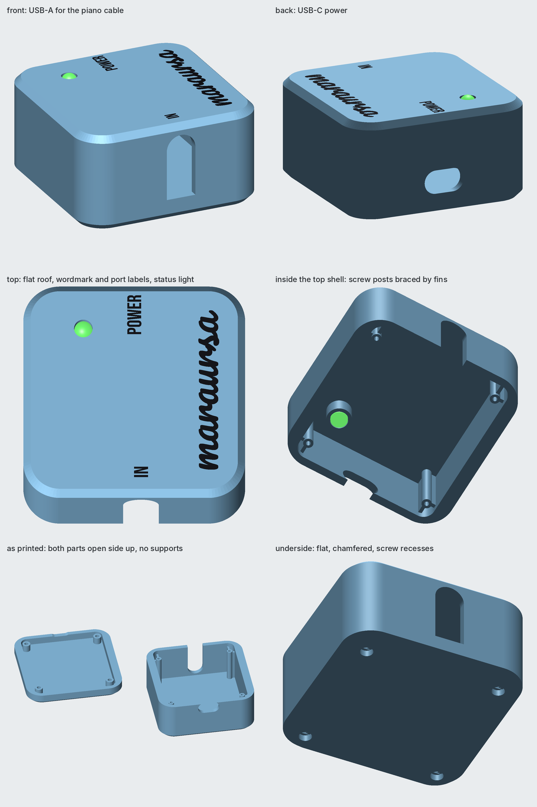

# pianolog case: FDM version (main)

The main case: flat roof and bottom, 61 × 61 × 31.6 mm, made to print on any home filament
printer **with no supports**. Board, openings, screws, lettering and status light are shared
with the [pitched-roof version](../pitched-roof/README.md); measurements, parts and assembly
are in the [case README](../README.md).

## Files

Print `out/top.3mf` and `out/bottom.3mf` (or the `.stl` / `.step` of the same name). The
source is `case.py`; `python fdm/case.py` from the `case/` folder rebuilds `out/`.

## How it avoids supports

* Flat roof and flat bottom, each printed **outside face down, open side up**, so both show
  the smooth (or textured) finish of the build plate and nothing inside hangs over air.
* 45° chamfers instead of fillets on the two edges that touch the plate. They print cleanly
  and hide elephant's foot (the squashed first layer).
* The lettering is engraved into the face on the plate; the letter floors are short bridges.
* Fins brace each screw post to the two nearest walls, so the thin posts neither wobble while
  printing nor split when the screws cut their thread.
* A two-layer sacrificial bridge above each screw-head recess (the hole-bridging trick), drawn
  for **0.2 mm layers**.
* The USB-A opening runs out through the rim as a slot, so no thin strip of wall is left.

`python overhangs.py --flip fdm/out/top.stl` reports what is left to bridge: the letter
floors, the two screw bridges and the 45° chamfers, all of which print without support.

## Slicer settings

* PETG, or PLA if the case never sits in sun or a hot car (PLA softens around 55–60 °C).
* 0.2 mm layers (the screw bridges are drawn for this height).
* **4 perimeters**, so the posts come out solid; 15–20 % infill.
* Supports off, "detect bridging perimeters" on, no brim needed.
* A textured PEI sheet gives the roof a uniform matte grain.
* Print the bottom shell first as a fit test.

## Lettering in a second colour

* With several filaments (e.g. a Bambu printer with AMS): load `out/top.3mf` and
  `out/top_text.3mf` together as one object with two parts, and give the text part the
  second filament.
* With one filament: fill the engraving with acrylic paint or a paint marker and wipe the
  surface clean with a slightly damp cloth before it dries.
