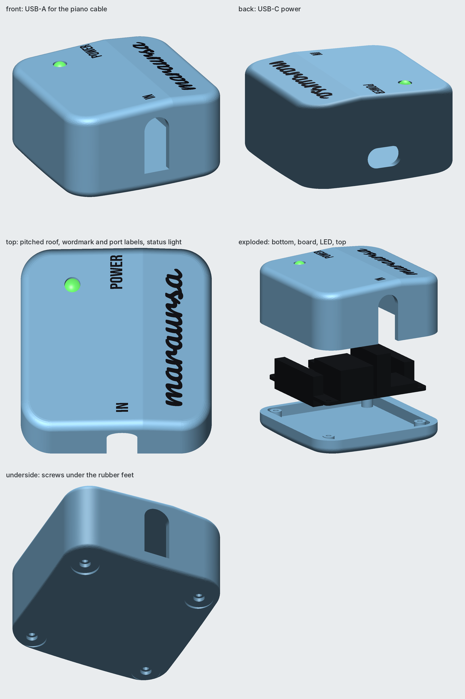

# pianolog case: pitched-roof version (ambitious)

The nicer-looking case: 61 × 61 × 34.6 mm, a shallow pitched roof (the ridge runs front to
back, 2 mm high), a gently domed bottom and soft rounded edges, with the wordmark on the
narrow side of the roof. Board, openings, screws, lettering and status light are shared with
the [FDM version](../fdm/README.md); measurements, parts and assembly are in the
[case README](../README.md).

It is the ambitious one because it needs a print service. On a home filament printer its
slopes show as stair steps and each part would need about 29 cm² of support. Print the
[FDM version](../fdm/README.md) first to check the fit.

## Files

Send `out/top.step` and `out/bottom.step` to the print service (`.3mf` and `.stl` of the same
name are there too). The source is `case.py`; `python pitched-roof/case.py` from the `case/`
folder rebuilds `out/`.

The bottom has a 0.6 mm recess for each rubber foot, over the screw head; the feet also keep
the domed bottom from rocking.

## Printing

* **Best result: MJF (HP Multi Jet Fusion) in PA12 nylon, dyed black.** Matte, even, no
  layer lines, so the gentle domes come out smooth; tough enough for the thin screw posts.
  Ask for vapour smoothing if you want a satin, near-smooth surface.
* **SLA resin, black:** the smoothest and most glossy-capable surface; more brittle, so
  don't overtighten the screws.

## Lettering in a second colour

MJF and SLA print one colour: fill the 1 mm engraving with acrylic paint or a paint marker
and wipe the surface clean with a slightly damp cloth before it dries. `out/top_text.*` is
the lettering as its own body, if a service offers multi-colour printing.
